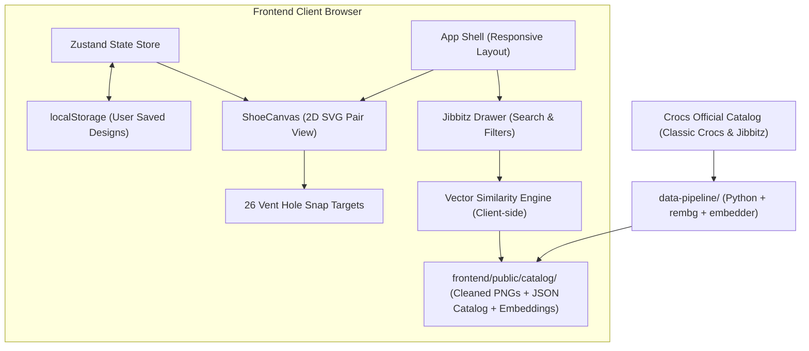

# Architecture & System Design: Crocs Visualizer

**Status:** Active  
**Version:** 1.0.0-beta  

---

## 1. System Overview

Crocs Visualizer is a client-first, responsive web application structured as a monorepo containing three primary packages:

1. **`frontend/`**: Single-Page Application (React 19 + TypeScript + Vite + Tailwind CSS v4) rendering the 2D SVG canvas and managing user interactions.
2. **`shared/`**: Common TypeScript domain types, coordinate matrices, and sizing formulas used across packages.
3. **`data-pipeline/`**: Python-based batch processing tool for Crocs catalog ingestion, image background removal, and vector embedding generation.

---

## 2. Coordinate System & Snapping Engine

- **Pair Layout:** Left and Right Crocs rendered side-by-side on a normalized coordinate grid `(0, 0, 1000, 600)`.
- **Hole Coordinates:** 13 holes per shoe (total 26 holes) mapped to proportional coordinates `(x, y)` relative to each shoe's bounding box.
- **Dynamic Sizing:** Footwear outlines scale according to size categories (Infant: 0.65x, Kids: 0.8x, Youth: 0.9x, Adult: 1.0x).
- **Proximity Snapping:** Dropped charms snap to the nearest unoccupied hole coordinate within a 24px radius.

---

## 3. Interaction Mechanics

- **Drag & Drop:** `@dnd-kit` manages touch and pointer drag lifecycles with touch cancellation prevention.
- **Rotation:** A placed charm features a circular drag ring allowing $360^\circ$ continuous rotation.
- **3-Click Deletion:**
  - Click 1: Selects the charm, displaying the bounding halo and rotation ring.
  - Clicks 2 & 3 (Double-click/double-tap within 400ms): Confirms deletion and returns the charm to the unplaced state.
